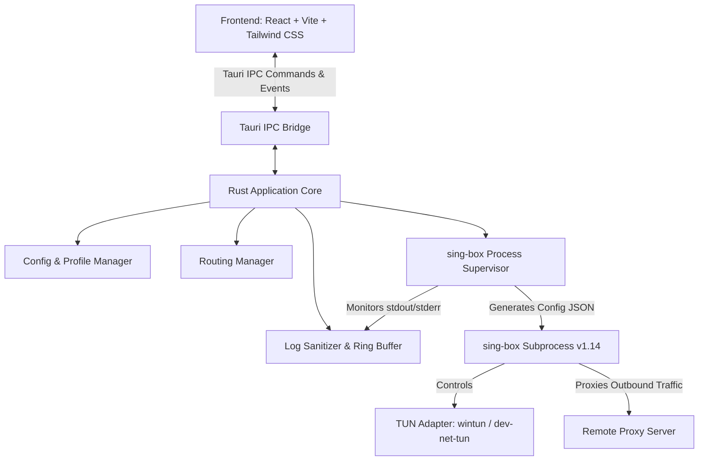

# RustyBox — Modern Desktop VPN Client

[](LICENSE)
[](https://github.com/SagerNet/sing-box)
[](https://tauri.app/)
[](https://www.rust-lang.org/)
[](https://react.dev/)

RustyBox is a modern, lightweight, cross-platform desktop VPN client built with **Tauri 2**, **Rust**, and **React / TypeScript**. It uses [sing-box](https://github.com/SagerNet/sing-box) (v1.14+) as a dedicated, fully managed network core process to provide high-performance TUN-based proxy routing.

---

## Table of Contents

- [Features](#features)
- [Architecture](#architecture)
- [Prerequisites](#prerequisites)
  - [Windows](#windows)
  - [Linux](#linux)
- [Building from Source](#building-from-source)
  - [Automated Scripts](#automated-scripts)
  - [Manual Build Steps](#manual-build-steps)
- [Permissions & Network Drivers](#permissions--network-drivers)
  - [Windows (`wintun.dll`)](#windows-wintundll)
  - [Linux (TUN & Capabilities)](#linux-tun--capabilities)
- [Usage Guide](#usage-guide)
  - [Importing Profiles](#importing-profiles)
  - [Connecting & Disconnecting](#connecting--disconnecting)
  - [Domain-Based Routing](#domain-based-routing)
  - [Diagnostic Logs & Secret Sanitization](#diagnostic-logs--secret-sanitization)
- [Testing & Manual Verification](#testing--manual-verification)
  - [Automated Test Suite](#automated-test-suite)
  - [Verifying TUN Interface](#verifying-tun-interface)
  - [Verifying Domain Routing Rules](#verifying-domain-routing-rules)
  - [Verifying DNS Leak Protection & Hijack](#verifying-dns-leak-protection--hijack)
- [Agent & Developer Guide (`AGENTS.md`)](#agent--developer-guide-agentsmd)
- [Licensing & Compliance](#licensing--compliance)

---

## Features

- **Protocols Supported**:
  - **VLESS**: REALITY with `x25519` key exchange, TLS fallback, UUID authentication, `xtls-rprx-vision` flow.
  - **Shadowsocks**: Standard AEAD (`aes-128-gcm`, `aes-256-gcm`, `chacha20-ietf-poly1305`) and AEAD 2022 ciphers (`2022-blake3-aes-128-gcm`, `2022-blake3-aes-256-gcm`, `2022-blake3-chacha20-poly1305`).
- **TUN Virtual Network Interface**:
  - Full-system traffic capture via `rustybox-tun` virtual adapter (`172.19.0.1/30` IPv4 and `fdfe:dcba:9876::1/126` IPv6).
  - Explicit driver check for `wintun.dll` on Windows; avoids silent background installations.
- **Advanced Domain Routing Engine**:
  - Exact match (`exact`), suffix/wildcard match (`suffix`), and keyword match (`keyword`).
  - Configurable default action (`DIRECT` or `VPN`).
  - Automatic `action: "sniff"` rule to extract real domain names from TLS SNI and HTTP Host headers without client certs.
  - Full DNS interception via `{ "port": 53, "action": "hijack-dns" }` and `{ "protocol": "dns", "action": "hijack-dns" }`.
  - Automatic proxy server domain bypass rule (`outbound: "direct"`) to completely prevent routing loops.
- **Robust Subprocess Supervision**:
  - Fully asynchronous lifecycle (`Disconnected` &rarr; `Starting` &rarr; `Connected` &rarr; `Stopping` &rarr; `Error`).
  - Rapid click debounce protection (prevents double-spawn races).
  - Auto-restart recovery (up to 3 restart attempts with exponential backoff).
  - Clean shutdown guaranteed: SIGINT/CTRL_BREAK followed by SIGKILL, active adapter cleanup.
- **Security & Privacy First**:
  - Full secret masking: UUIDs, passwords, REALITY private keys, and base64 credentials are completely scrubbed from memory buffers, UI logs, and exported diagnostic bundles.
  - Local configuration stored in OS-standard app data directories (`%APPDATA%/rustybox` on Windows, `~/.config/rustybox` on Linux).
  - Corrupted config auto-recovery: backs up invalid config files and initializes clean defaults without data destruction.
- **Clean Desktop Integration**:
  - Native Windows Subsystem: strictly a GUI process (`IMAGE_SUBSYSTEM_WINDOWS_GUI`), completely eliminating console windows on launch.
  - System tray icon with real-time connection status (`Connected`, `Connecting`, `Disconnected`, `Error`).
  - "Close to tray" behavior to keep VPN active during multitasking.

---

## Architecture

RustyBox is designed with a strict separation of concerns:



1. **Frontend (React / TypeScript)**:
   - Presentation layer built with Tailwind CSS. Runs in WebView2 (Windows) or WebKitGTK (Linux).
   - Polls or listens to connection state, displays live log streams, and manages profile/routing forms.
2. **Backend (Rust & Tauri 2)**:
   - Owns application state (`AppState`) protected by asynchronous `tokio::sync::Mutex` locks.
   - Parses `vless://` and `ss://` URI formats.
   - Evaluates routing rules and generates valid `sing-box` 1.14 configurations on the fly.
   - Supervises the `sing-box` child process with graceful termination guarantees.
3. **Core (sing-box 1.14)**:
   - Runs as an unprivileged or elevated auxiliary process.
   - Captures system IP packets via TUN, terminates DNS queries safely, sniffs SNI domains, and routes packets to the target outbound.

---

## Prerequisites

### Windows
- **Operating System**: Windows 10/11 (64-bit).
- **Rust Toolchain**: `stable-x86_64-pc-windows-msvc` or `stable-x86_64-pc-windows-gnu` (Rust 1.78+).
- **WebView2 Runtime**: Installed by default on Windows 10/11.
- **Node.js**: Node 18+ and npm for frontend assets.
- **Binaries**:
  - `bin/sing-box.exe` (sing-box 1.14.3+)
  - `bin/wintun.dll` (Wintun TUN driver for Windows, v0.14+)

### Linux
- **Operating System**: Ubuntu 22.04+, Debian 12+, Fedora 38+, Arch Linux, etc.
- **Dependencies**:
  ```bash
  sudo apt-get update && sudo apt-get install -y \
    libwebkit2gtk-4.1-dev \
    build-essential \
    curl \
    wget \
    file \
    libxdo-dev \
    libssl-dev \
    libayatana-appindicator3-dev \
    librsvg2-dev
  ```
- **Node.js**: Node 18+ and npm.
- **Binaries**:
  - `bin/sing-box` (compiled with TUN and VLESS/REALITY support)

---

## Building from Source

### Automated Scripts

Pre-configured scripts automate downloading dependencies and compiling the project:

#### Windows
```powershell
# 1. Download sing-box and wintun.dll into bin/
.\scripts\download-singbox.ps1

# 2. Build debug binary
.\scripts\build-windows.ps1 -Configuration debug

# 3. Build optimized release binary
.\scripts\build-windows.ps1 -Configuration release
```

#### Linux
```bash
# 1. Download sing-box into bin/
chmod +x scripts/*.sh
./scripts/download-singbox.sh

# 2. Build debug binary
./scripts/build-linux.sh debug

# 3. Build optimized release binary
./scripts/build-linux.sh release
```

### Manual Build Steps

If you prefer building each component manually:

1. **Build Frontend**:
   ```bash
   cd frontend
   npm install
   npm run build
   cd ..
   ```
2. **Build Rust / Tauri**:
   ```bash
   cargo build --package rustybox --bin rustybox
   ```
   Or for production release:
   ```bash
   cargo build --release --package rustybox --bin rustybox
   ```

Binary output will be available at `target/debug/rustybox` (or `target/release/rustybox`).

---

## Permissions & Network Drivers

TUN-based VPN clients require elevated capabilities to create network adapters and modify routing tables.

### Windows (`wintun.dll`)
1. Place `wintun.dll` in `bin/wintun.dll` (or alongside `rustybox.exe`).
2. Run `rustybox.exe` as **Administrator** ("Run as administrator").
   - *Driver Safety*: RustyBox checks for the presence of `wintun.dll` and elevation before attempting to connect. If missing or unelevated, clear diagnostic instructions are presented to the user instead of silent failures.

### Linux (TUN & Capabilities)
TUN creation on Linux requires access to `/dev/net/tun` and `CAP_NET_ADMIN`.

To run without full `sudo` root for the desktop UI:
```bash
# Grant CAP_NET_ADMIN and CAP_NET_BIND_SERVICE to sing-box core
sudo setcap cap_net_admin,cap_net_bind_service=+ep bin/sing-box
```
Or allow your user access to `/dev/net/tun`:
```bash
sudo chmod 666 /dev/net/tun
```

---

## Usage Guide

### Importing Profiles

RustyBox supports one-click import from clipboard:

1. Copy your proxy URI:
   - **VLESS Reality**:
     ```text
     vless://uuid-goes-here@server.com:443?security=reality&sni=target.com&fp=chrome&pbk=PublicKey1234567890&sid=abcdef&flow=xtls-rprx-vision&type=tcp#MyRealityServer
     ```
   - **Shadowsocks**:
     ```text
     ss://YWVzLTI1Ni1nY206cGFzc3dvcmQ=@server.com:8388#MySSServer
     ```
2. Open RustyBox &rarr; Go to **Profiles** &rarr; Click **"Import from Clipboard"**.
3. Or click **"Add Profile"** to configure parameters manually.

### Connecting & Disconnecting

- On the **Connection** tab, select your profile from the dropdown.
- Click the large toggle button to connect.
- The UI transitions through `Starting` &rarr; `Connected`.
- A session duration timer displays live uptime.
- Click the toggle again to disconnect gracefully.

### Domain-Based Routing

Navigate to the **Routing** tab to configure domain policies:
- **Default Action**: Choose whether unlisted domains go `DIRECT` (bypass VPN) or `VPN` (proxy everything).
- **Rule Management**:
  - Add rules with types:
    - `Exact`: Matches `example.com`.
    - `Suffix`: Matches `.example.com` and all subdomains (e.g., `api.example.com`).
    - `Keyword`: Matches any domain containing the keyword (e.g., `google`).
  - Toggle rule action between `DIRECT` and `VPN`.
- **Import / Export**: Export your rule configuration as a JSON file to share across devices.

### Diagnostic Logs & Secret Sanitization

Navigate to the **Logs** tab:
- Live view of backend activity and `sing-box` stderr/stdout.
- Filter by level (`DEBUG`, `INFO`, `WARN`, `ERROR`).
- Click **"Copy Diagnostic Report"** to copy a sanitized log bundle.
- **Privacy Guarantee**: All UUIDs, passwords, REALITY private keys, and base64 hashes are automatically replaced with `[REDACTED_UUID]`, `[REDACTED_SECRET]`, or `[REDACTED_KEY]` before rendering or export.

---

## Testing & Manual Verification

### Automated Test Suite

RustyBox includes a comprehensive unit and integration test suite covering all 12 core test scenarios:

```bash
# Run headless unit and integration tests (recommended for rapid verification)
cargo test --no-default-features
```

Test scenarios covered:
1. `test_scenario_01_parse_valid_vless_uri` (VLESS Reality URI parser)
2. `test_scenario_02_parse_valid_shadowsocks_uri` (Shadowsocks SIP002 & legacy)
3. `test_scenario_03_reject_invalid_uris` (rejection of malformed URIs, ports, UUIDs)
4. `test_scenario_04_save_and_load_profiles` (JSON serialization & persistence)
5. `test_scenario_05_add_edit_delete_rules` (routing rules CRUD)
6. `test_scenario_06_rule_priority_and_order` (rule reordering and priority evaluation)
7. `test_scenario_07_singbox_config_generation` (sing-box 1.14 typed DNS & route validation)
8. `test_scenario_08_secret_masking` (credential redaction in logs and bundles)
9. `test_scenario_09_repeated_connect_click` (debounce protection against double-spawn)
10. `test_scenario_10_state_transitions` (Disconnected -> Starting -> Connected -> Stopping)
11. `test_scenario_11_failed_core_launch` (graceful failure to Error state)
12. `test_scenario_12_stop_core_when_not_running` (safe idempotent Stop calls)

### Verifying TUN Interface

1. Start connection in RustyBox (running as Administrator on Windows or with root capabilities on Linux).
2. In PowerShell (Administrator):
   ```powershell
   Get-NetAdapter | Where-Object { $_.InterfaceDescription -like "*wintun*" }
   ```
   You should see `rustybox-tun` in `Up` status.
3. Check routing table:
   ```powershell
   Get-NetRoute -InterfaceAlias "rustybox-tun"
   ```

### Verifying Domain Routing Rules

1. Add a rule: `suffix: "ifconfig.me"` &rarr; `VPN`.
2. Add a rule: `suffix: "icanhazip.com"` &rarr; `DIRECT`.
3. Test from your terminal:
   ```bash
   curl https://ifconfig.me   # Outputs Proxy Server IP
   curl https://icanhazip.com # Outputs Your Real ISP IP
   ```

### Verifying DNS Leak Protection & Hijack

RustyBox intercepts all DNS requests via `{ "port": 53, "action": "hijack-dns" }` and `{ "protocol": "dns", "action": "hijack-dns" }`:
```powershell
nslookup whoami.akamai.net 172.19.0.2
```
Verify that DNS queries are handled through the encrypted proxy tunnel and no unencrypted UDP DNS leaks to your local ISP.

---

## Agent & Developer Guide (`AGENTS.md`)

For artificial intelligence coding assistants and developers contributing to this repository, a comprehensive operational guide is available in [AGENTS.md](AGENTS.md). It outlines:
- Environment and toolchain requirements (Windows MinGW/GNU toolchain paths, incremental compilation flags).
- sing-box 1.14 syntax and configuration requirements.
- Step-by-step instructions for running tests, formatting, and compiling.
- Troubleshooting common Windows desktop, Job Object, and TUN driver issues.

---

## Licensing & Compliance

### RustyBox
RustyBox application source code, UI, and Rust backend are released under the [MIT License](LICENSE).

### sing-box Compliance Notice
RustyBox executes [sing-box](https://github.com/SagerNet/sing-box) as an external, independent subprocess.
- `sing-box` is licensed under the **GNU General Public License v3.0 (GPLv3)**.
- RustyBox does **not** link against sing-box as a static or dynamic library. Communication is strictly through command-line invocations, JSON configuration files, and standard process I/O.
- The sing-box source code is available at [https://github.com/SagerNet/sing-box](https://github.com/SagerNet/sing-box).
- When distributing pre-packaged releases containing the `sing-box` binary, a copy of the GPLv3 license and link to the corresponding sing-box source release is included in accordance with GPLv3 Section 6.
