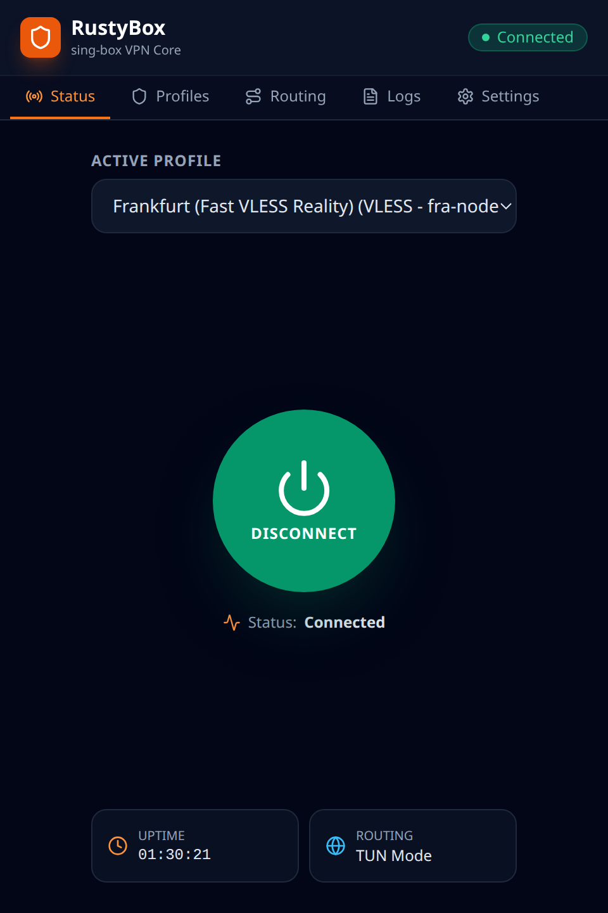
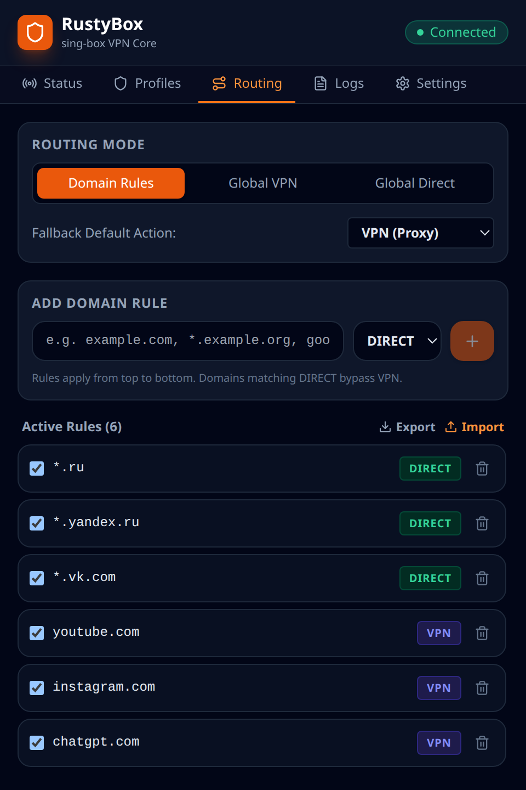
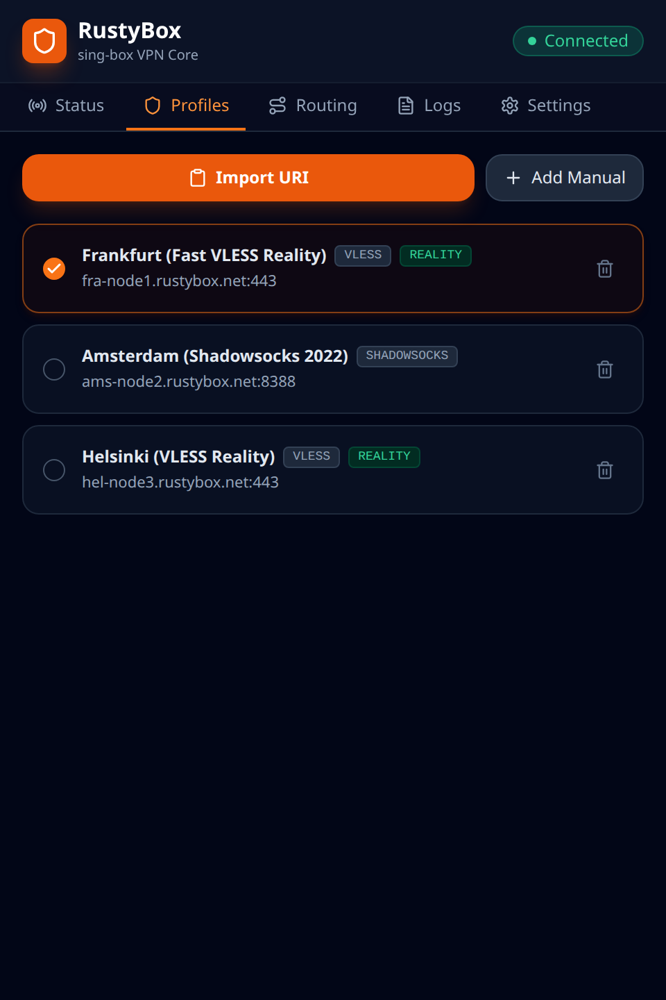
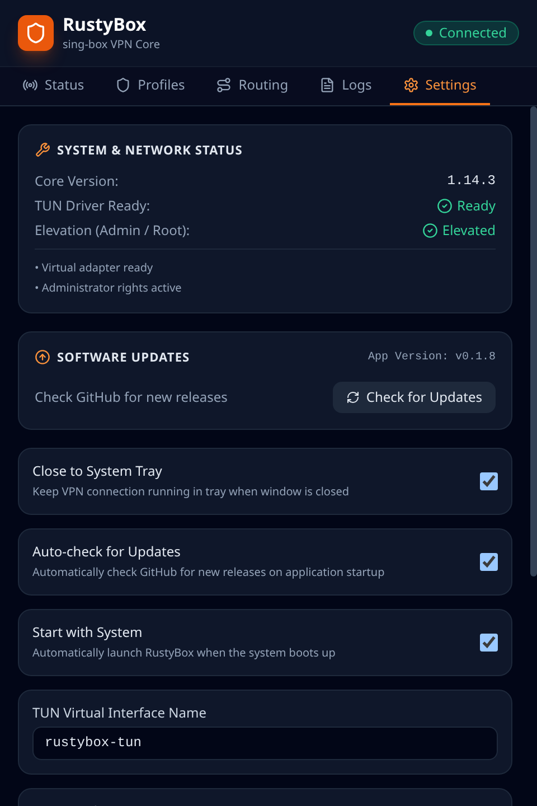
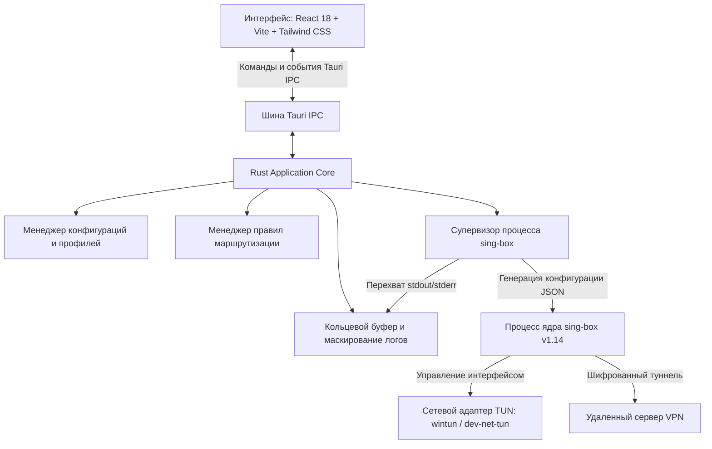

# RustyBox — современный десктопный VPN-клиент

[](LICENSE)
[](https://github.com/SagerNet/sing-box)
[](https://tauri.app/)
[](https://www.rust-lang.org/)
[](https://react.dev/)
[](https://github.com/jools333/RustyBox)

**RustyBox** — это быстрый, легковесный и безопасный кроссплатформенный VPN-клиент для операционных систем Windows и Linux, построенный на базе фреймворка **Tauri 2**, языка **Rust** и **React 18 / TypeScript**.

В качестве высокопроизводительного сетевого ядра используется **[sing-box](https://github.com/SagerNet/sing-box)** (версии 1.14+), запускаемый в виде изолированного дочернего процесса. RustyBox направляет сетевой трафик через системный виртуальный сетевой адаптер **TUN** (`rustybox-tun` / Wintun), поддерживает современные протоколы **VLESS Reality** и **Shadowsocks 2022**, интеллектуальную маршрутизацию по доменным правилам (прямой трафик / VPN), перехват DNS, автоматический запрос прав администратора (UAC) на Windows и автозапуск вместе с системой.

---

## 📸 Скриншоты интерфейса

| Главный экран (Подключение) | Правила маршрутизации |
| :---: | :---: |
|  |  |

| Профили подключения | Настройки приложения |
| :---: | :---: |
|  |  |

---

## Оглавление

- [Основные возможности](#основные-возможности)
- [Скриншоты интерфейса](#-скриншоты-интерфейса)
- [Поддерживаемые протоколы](#поддерживаемые-протоколы)
- [Архитектура](#архитектура)
- [Системные требования](#системные-требования)
  - [Windows](#windows)
  - [Linux](#linux)
- [Сборка из исходного кода](#сборка-из-исходного-кода)
  - [Автоматическая сборка скриптами](#автоматическая-сборка-скриптами)
  - [Ручная пошаговая сборка](#ручная-пошаговая-сборка)
- [Сетевые драйверы и права доступа](#сетевые-драйверы-и-права-доступа)
  - [Windows (Wintun и UAC)](#windows-wintundll-и-права-администратора)
  - [Linux (TUN и Capabilities)](#linux-tun-и-права-cap_net_admin)
- [Руководство пользователя](#руководство-пользователя)
  - [Импорт профилей (VLESS / Shadowsocks)](#импорт-профилей)
  - [Подключение и отключение](#подключение-и-отключение)
  - [Настройка правил маршрутизации (Direct / VPN)](#настройка-правил-маршрутизации)
  - [Автозапуск вместе с системой](#автозапуск-вместе-с-системой)
  - [Автоматические обновления](#автоматические-обновления)
  - [Диагностические логи и защита секретов](#диагностические-логи-и-защита-секретов)
- [Тестирование и проверка](#тестирование-и-проверка)
  - [Автоматические тесты](#автоматические-тесты)
  - [Проверка сетевого адаптера TUN](#проверка-сетевого-адаптера-tun)
  - [Проверка правил маршрутизации](#проверка-правил-маршрутизации)
  - [Проверка перехвата DNS и защиты от утечек](#проверка-перехвата-dns-и-защиты-от-утечек)
- [Руководство для разработчиков (AGENTS.md)](#руководство-для-разработчиков-agentsmd)
- [Лицензирование и соответствие GPLv3](#лицензирование-и-соответствие-gplv3)

---

## Основные возможности

- **Современные протоколы обхода блокировок**:
  - **VLESS REALITY**: эллиптическая кривая `x25519`, аутентификация по UUID v4, маскировка под популярные TLS-сайты (SNI, Chrome fingerprint) и поток `xtls-rprx-vision`.
  - **Shadowsocks**: современные шифры AEAD 2022 (`2022-blake3-aes-128-gcm`, `2022-blake3-aes-256-gcm`, `2022-blake3-chacha20-poly1305`), а также классические шифры AEAD (`aes-128-gcm`, `aes-256-gcm`, `chacha20-ietf-poly1305`).
- **Полноценный виртуальный сетевой адаптер TUN**:
  - Полный перехват трафика на уровне сетевого стека ОС через виртуальный адаптер `rustybox-tun` (`172.19.0.1/30` IPv4 и `fdfe:dcba:9876::1/126` IPv6).
  - На Windows используется высокоскоростной драйвер **Wintun** (v0.14+). Программа проверяет наличие драйвера и прав перед запуском ядра.
- **Интеллектуальная маршрутизация по доменам (Routing Engine)**:
  - Режимы работы: **Маршрутизация по правилам (Domain Rules)**, **Полный VPN (Global VPN)** или **Прямой трафик (Global Direct)**.
  - Настройка действия по умолчанию (Fallback Action): направлять несовпадающие сайты через `VPN` или напрямую `DIRECT`.
  - Поддержка точного совпадения (`exact`), суффиксов и поддоменов (`suffix`, `*.example.com`) и ключевых слов (`keyword`).
  - Автоматическое распознавание реальных доменов через protocol sniffing (`action: "sniff"` для TLS SNI и HTTP Host).
  - Тотальный перехват и защита от утечек DNS через `{ "port": 53, "action": "hijack-dns" }` и `{ "protocol": "dns", "action": "hijack-dns" }`.
  - Автоматическое прямое исключение для адреса самого прокси-сервера (`outbound: "direct"`), гарантирующее отсутствие циклических маршрутов.
- **Интеграция с операционной системой**:
  - **Автозапуск с системой**: возможность запуска RustyBox в фоне при старте Windows/Linux через настройки приложения.
  - **UAC-запрос прав администратора**: при запуске на Windows программа проверяет привилегии и, подобно NekoBox, запрашивает повышение прав через стандартный диалог UAC, а также предоставляет кнопку перезапуска с правами администратора.
  - **Сворачивание в системный трей (Close to Tray)**: работа в фоновом режиме без загромождения панели задач, индикация статуса подключения в иконке трея.
  - **Чистый GUI-процесс**: на Windows сборка компилируется с флагом `IMAGE_SUBSYSTEM_WINDOWS_GUI`, исключая появление паразитных черных консольных окон.
  - **Встроенные обновления**: проверка и установка релизов с GitHub Releases в один клик с проверкой криптографической подписи Minisign / Ed25519.
- **Безопасность и конфиденциальность**:
  - **Маскирование секретов**: все UUID, пароли, приватные ключи REALITY и base64-токены автоматически маскируются (`[REDACTED_UUID]`, `[REDACTED_SECRET]`, `[REDACTED_KEY]`) в оперативной памяти, в отображаемом журнале логов и при экспорте диагностических отчетов.
  - **Надежное хранение конфигурации**: пользовательские настройки и профили сохраняются в системной папке приложения (`%APPDATA%/rustybox` на Windows, `~/.config/rustybox` на Linux) с автоматическим резервным копированием при повреждении файлов (`config.json.corrupted.<timestamp>`).

---

## Архитектура

RustyBox спроектирован по модульному принципу с четким разделением уровней:



1. **Frontend (React 18 / TypeScript)**:
   - Презентационный слой в WebView2 (Windows) или WebKitGTK (Linux).
   - Интуитивный интерфейс с темной темой, отображением аптайма, списком профилей с замером задержки, редактором правил маршрутизации, журналом логов и настройками.
2. **Backend (Rust & Tauri 2)**:
   - Управление состоянием (`AppState`), защищенное асинхронными мьютексами `tokio::sync::Mutex`.
   - Парсинг URI-ссылок `vless://` и `ss://`.
   - Генерация валидной конфигурации `sing-box` 1.14 на лету с типизированными DNS-серверами и правилами маршрутов.
   - Надежный супервизор процесса ядра с автоматическим корректным завершением (SIGINT -> SIGKILL) и очисткой виртуального адаптера.
3. **Core (sing-box 1.14)**:
   - Автономный бинарный файл, запускаемый клиентом с сетевыми привилегиями.
   - Захватывает IP-пакеты системы, перехватывает DNS-запросы и туннелирует трафик в выбранный протокол.

---

## Поддерживаемые протоколы

| Протокол | Шифрование / Транспорт | Аутентификация | Особенности |
|---|---|---|---|
| **VLESS** | REALITY (`x25519`), TLS, TCP | UUID v4 | Поток `xtls-rprx-vision`, маскировка под сторонние домены (SNI), Chrome fingerprint |
| **Shadowsocks 2022** | `2022-blake3-aes-128-gcm`<br>`2022-blake3-aes-256-gcm`<br>`2022-blake3-chacha20-poly1305` | Предопределенный ключ (PSK) | Высокая устойчивость к DPI, сниженные накладные расходы |
| **Shadowsocks AEAD** | `aes-128-gcm`, `aes-256-gcm`, `chacha20-ietf-poly1305` | Пароль | Классический стандарт SIP002 |

---

## Системные требования

### Windows
- **Операционная система**: Windows 10 или Windows 11 (64-бит).
- **Среда выполнения**: Microsoft Edge WebView2 Runtime (установлен по умолчанию в современных версиях Windows).
- **Драйвер TUN**: `wintun.dll` (v0.14+, размещается в папке `bin/` или рядом с исполняемым файлом).
- **Права администратора**: требуются для создания виртуального адаптера Wintun и настройки системных маршрутов (клиент запрашивает их автоматически через UAC).

### Linux
- **Операционная система**: Ubuntu 22.04+, Debian 12+, Fedora 38+, Arch Linux и др.
- **Сетевые возможности**: поддержка ядра Linux для модуля `tun` (`/dev/net/tun`) и права `CAP_NET_ADMIN` для сетевого ядра `sing-box`.
- **Системные пакеты для сборки**:
  ```bash
  sudo apt-get update && sudo apt-get install -y \
    libwebkit2gtk-4.1-dev \
    build-essential \
    curl \
    wget \
    file \
    libxdo-dev \
    libssl-dev \
    libayatana-appindicator3-dev \
    librsvg2-dev
  ```

---

## Сборка из исходного кода

### Автоматическая сборка скриптами

В репозитории подготовлены скрипты для автоматической загрузки ядра `sing-box`, драйвера Wintun и компиляции проекта:

#### Windows (PowerShell)
```powershell
# 1. Скачивание sing-box.exe и wintun.dll в директорию bin/
.\scripts\download-singbox.ps1

# 2. Сборка debug-версии
.\scripts\build-windows.ps1 -Configuration debug

# 3. Сборка релизной оптимизированной версии
.\scripts\build-windows.ps1 -Configuration release
```

#### Linux (Bash)
```bash
# 1. Загрузка sing-box в bin/
chmod +x scripts/*.sh
./scripts/download-singbox.sh

# 2. Сборка debug-бинарника
./scripts/build-linux.sh debug

# 3. Сборка релизного бинарника
./scripts/build-linux.sh release
```

### Ручная пошаговая сборка

Если вы собираете проект вручную:

1. **Сборка фронтенда**:
   ```bash
   cd frontend
   npm install
   npm run build
   cd ..
   ```
2. **Сборка Rust / Tauri бэкенда**:
   ```bash
   cargo build --package rustybox --bin rustybox
   ```
   Для релизной сборки:
   ```bash
   cargo build --release --package rustybox --bin rustybox
   ```

Скомпилированный файл будет находиться по пути `target/debug/rustybox` (или `target/release/rustybox`). Не забудьте поместить `sing-box` (и `wintun.dll` на Windows) рядом с бинарником или в папку `bin/`.

---

## Сетевые драйверы и права доступа

Для работы системного виртуального адаптера TUN требуются сетевые привилегии уровня операционной системы:

### Windows (`wintun.dll` и права администратора)
1. RustyBox использует драйвер Wintun. Файл `wintun.dll` должен находиться рядом с программой или в папке `bin/wintun.dll`.
2. При запуске RustyBox автоматически проверяет наличие прав администратора. Если программа запущена от имени обычного пользователя, на главном экране отображается предупреждение с кнопкой **«Restart as Administrator»**, либо вызывается стандартный системный диалог UAC.

### Linux (TUN и права `CAP_NET_ADMIN`)
Для работы TUN в Linux без постоянного использования `sudo` для всего графического интерфейса достаточно выдать сетевые возможности ядру `sing-box`:
```bash
# Выдача сетевых capabilities бинарнику ядра
sudo setcap cap_net_admin,cap_net_bind_service=+ep bin/sing-box
```
Или предоставить права на устройство `/dev/net/tun`:
```bash
sudo chmod 666 /dev/net/tun
```

---

## Руководство пользователя

### Импорт профилей

RustyBox поддерживает быстрый импорт конфигураций из буфера обмена:
1. Скопируйте ссылку конфигурации вашего сервера:
   - **VLESS Reality**:
     ```text
     vless://uuid-goes-here@server.com:443?security=reality&sni=target.com&fp=chrome&pbk=PublicKey1234567890&sid=abcdef&flow=xtls-rprx-vision&type=tcp#MyServer
     ```
   - **Shadowsocks**:
     ```text
     ss://YWVzLTI1Ni1nY206cGFzc3dvcmQ=@server.com:8388#MyServer
     ```
2. Откройте вкладку **Profiles** в RustyBox.
3. Нажмите **«Import URI»** (или **«Import from Clipboard»**).
4. Также доступно ручное добавление через кнопку **«Add Manual»**.

### Подключение и отключение

- На вкладке **Status** выберите нужный профиль из выпадающего списка.
- Нажмите центральную кнопку питания для подключения.
- Статус изменится: `Starting` &rarr; `Connected`.
- Таймер начнет отсчет времени активной сессии.
- Для отключения нажмите кнопку повторно.

### Настройка правил маршрутизации

На вкладке **Routing** можно гибко настраивать политики маршрутизации трафика:
- **Режимы маршрутизации**:
  - `Domain Rules`: выборочное проксирование на основе списка правил.
  - `Global VPN`: весь системный трафик идет через VPN.
  - `Global Direct`: весь трафик идет напрямую в обход VPN.
- **Действие по умолчанию (Fallback Default Action)**:
  - `VPN (Proxy)`: если домен не найден в правилах, он идет через VPN.
  - `DIRECT`: если домен не найден в правилах, он идет напрямую от вашего провайдера.
- **Типы правил**:
  - Доменные шаблоны: `*.ru`, `yandex.ru`, `youtube.com`, `instagram.com` и т.д.
  - Действие для правила: `DIRECT` (в обход VPN) или `VPN` (через прокси-сервер).
  - Быстрое включение/отключение любого правила чекбоксом или удаление.
- **Импорт / Экспорт**: сохраняйте и загружайте списки правил в формате JSON.

### Автозапуск вместе с системой

На вкладке **Settings** доступен переключатель **«Start with System»**:
- При включении RustyBox будет автоматически запускаться при загрузке операционной системы.
- Включение опции **«Close to System Tray»** позволяет при закрытии окна оставлять соединение активным в фоновом режиме в системном трее.

### Автоматические обновления

- RustyBox проверяет наличие новых версий на GitHub Releases при запуске.
- Проверить обновления вручную можно в любое время на вкладке **Settings** кнопкой **«Check for Updates»**.
- Обновления защищены цифровой криптографической подписью Minisign. Перед применением обновления клиент безопасно останавливает активную сессию VPN, освобождая драйверы.

### Диагностические логи и защита секретов

На вкладке **Logs**:
- Живой поток системных событий RustyBox и ядра `sing-box`.
- Кнопка **«Copy Diagnostic Report»** копирует полный отчет о системе и подключении для отправки в поддержку.
- **Гарантия конфиденциальности**: пароли, приватные ключи REALITY, UUID и токены маскируются в логах и отчетах маской `[REDACTED]`.

---

## Тестирование и проверка

### Автоматические тесты

В репозитории реализован полный набор юнит- и интеграционных тестов:
```bash
cargo test --no-default-features
```

Сценарии тестирования включают:
1. `test_scenario_01_parse_valid_vless_uri` — парсинг VLESS Reality URI.
2. `test_scenario_02_parse_valid_shadowsocks_uri` — парсинг Shadowsocks (SIP002 и AEAD 2022).
3. `test_scenario_03_reject_invalid_uris` — отклонение некорректных URI и невалидных UUID.
4. `test_scenario_04_save_and_load_profiles` — сериализация и сохранение профилей.
5. `test_scenario_05_add_edit_delete_rules` — CRUD-операции правил маршрутизации.
6. `test_scenario_06_rule_priority_and_order` — приоритет и сортировка правил.
7. `test_scenario_07_singbox_config_generation` — генерация валидного JSON sing-box 1.14 с типизированными DNS.
8. `test_scenario_08_secret_masking` — маскирование секретов и паролей в логах.
9. `test_scenario_09_repeated_connect_click` — защита от дребезга и повторных кликов подключения.
10. `test_scenario_10_state_transitions` — жизненный цикл состояний подключения.
11. `test_scenario_11_failed_core_launch` — корректная обработка ошибок запуска ядра.
12. `test_scenario_12_stop_core_when_not_running` — идемпотентная остановка неактивного ядра.

### Проверка сетевого адаптера TUN

После подключения к VPN на Windows в PowerShell (Администратор):
```powershell
Get-NetAdapter | Where-Object { $_.InterfaceDescription -like "*wintun*" }
```
Адаптер `rustybox-tun` должен иметь статус `Up`.

Таблица маршрутов:
```powershell
Get-NetRoute -InterfaceAlias "rustybox-tun"
```

### Проверка правил маршрутизации

1. Создайте правило: `suffix: "ifconfig.me"` &rarr; `VPN`.
2. Создайте правило: `suffix: "icanhazip.com"` &rarr; `DIRECT`.
3. Выполните проверку в терминале:
   ```bash
   curl https://ifconfig.me   # Возвращает IP-адрес прокси-сервера
   curl https://icanhazip.com # Возвращает ваш реальный IP-адрес провайдера
   ```

### Проверка перехвата DNS и защиты от утечек

RustyBox перехватывает все DNS-запросы на порту 53:
```powershell
nslookup whoami.akamai.net 172.19.0.2
```
Запросы резолвятся через безопасный зашифрованный туннель, полностью предотвращая утечки DNS вашему интернет-провайдеру.

---

## Руководство для разработчиков (`AGENTS.md`)

Для разработчиков и AI-ассистентов в репозитории предусмотрен подробный технический регламент: **[AGENTS.md](AGENTS.md)**.
В нем описаны:
- Особенности тулчейна Windows MinGW/GNU и переменные окружения.
- Правила синтаксиса конфигурации `sing-box` 1.14 (типы DNS-серверов, правила без циклов).
- Команды линтинга (`cargo clippy -D warnings`), форматирования (`cargo fmt`) и сборки.
- Правила безопасности и изоляции ядра.

---

## Лицензирование и соответствие GPLv3

### Лицензия RustyBox
Исходный код клиентского приложения RustyBox, пользовательский интерфейс и Rust-бэкенд распространяются под свободной лицензией **[MIT](LICENSE)**.

### Соответствие лицензии sing-box (GPLv3)
RustyBox использует ядро **[sing-box](https://github.com/SagerNet/sing-box)** в качестве внешнего независимого подпроцесса.
- `sing-box` лицензирован под **GNU General Public License v3.0 (GPLv3)**.
- RustyBox **не** линкуется с sing-box в виде статической или динамической библиотеки. Взаимодействие осуществляется исключительно через аргументы командной строки, JSON-конфигурационные файлы и стандартные потоки ввода-вывода (IPC/Pipes).
- Исходный код sing-box доступен в официальном репозитории: [https://github.com/SagerNet/sing-box](https://github.com/SagerNet/sing-box).
- При распространении бинарных сборок RustyBox, содержащих исполняемый файл sing-box, текст лицензии GPLv3 и ссылки на исходный код sing-box прилагаются в полном соответствии с разделом 6 лицензии GPLv3.
